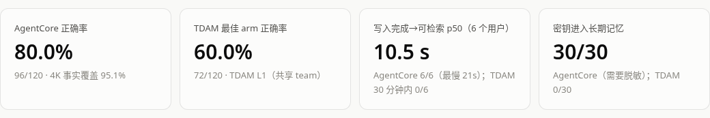
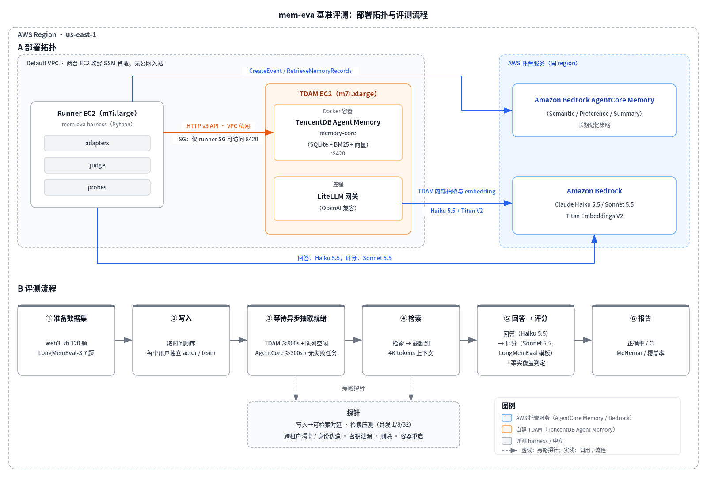
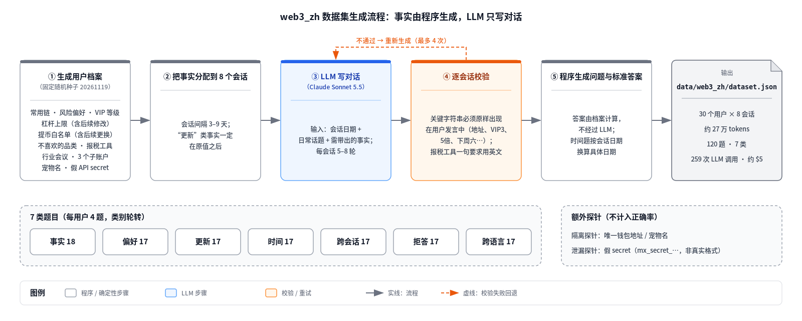
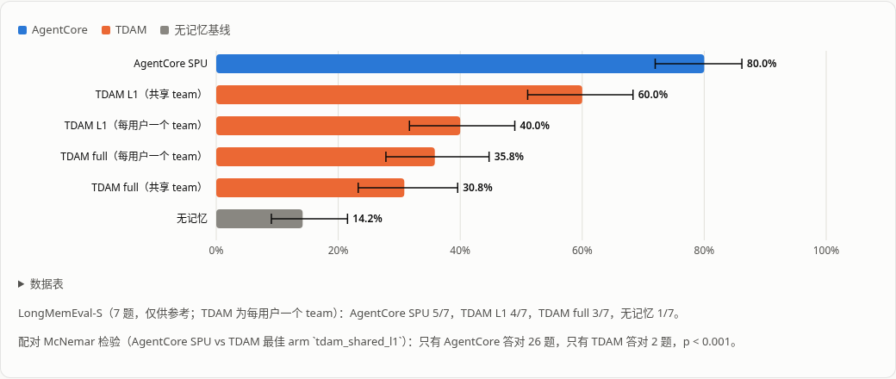
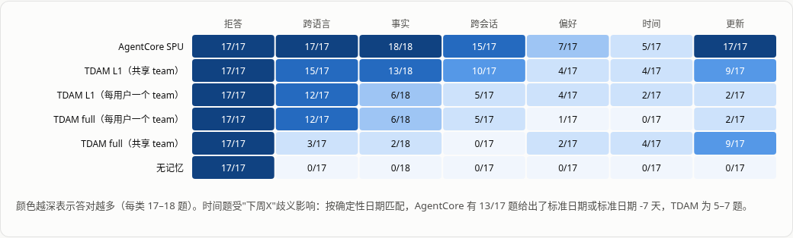
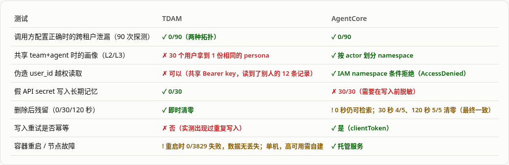
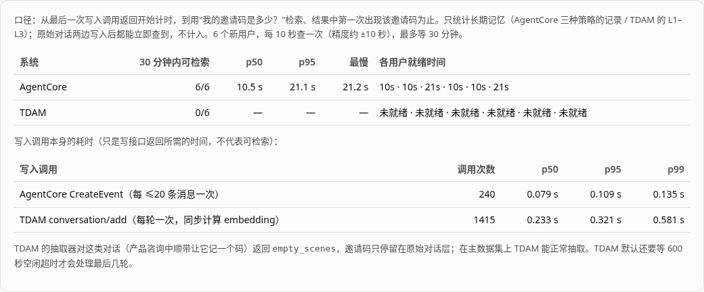
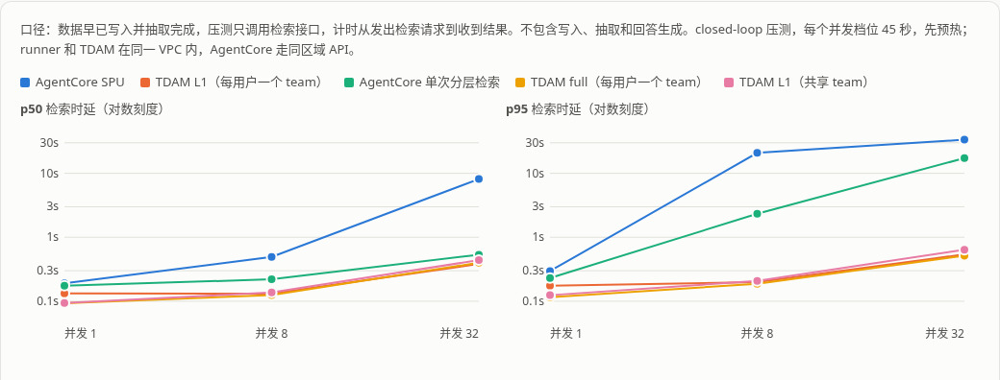

# mem-eva：Agent 记忆系统评测框架

这个仓库回答一个具体问题：**给交易所的 AI 助手配长期记忆，选自建的 TencentDB Agent Memory（下文简称 TDAM），还是托管的 Amazon Bedrock AgentCore Memory，两者差在哪里。**

我们没有只跑一个公开榜单，而是照着交易所助手的实际需要设计测试：
- 记得准不准；
- 不同用户的信息会不会串；
- 写进去多久能查到；
- 并发上来扛不扛得住；
- 能不能删干净；
- 用户贴进来的密钥会不会也被“记住”；
- 要花多少钱。

代码、数据集和原始结果都在这里，可以原样复跑，也可以换成你们自己的数据和配置再跑一遍。

| 文档 | 内容 |
|---|---|
| [`docs/REPORT.md`](docs/REPORT.md) | 完整评测报告 |
| <https://cdn.chrisai.blog/mem-eva-report.html> | 交互式图表（悬停可看数值） |
| [`docs/DESIGN.md`](docs/DESIGN.md) | 设计文档与修订记录 |
| [`docs/CONFIG_DIFF.md`](docs/CONFIG_DIFF.md) | TDAM 每一项配置改动及理由 |
| [`reports/final/`](reports/final/) | 汇总数据和逐题结果 |

---

## 背景：被测系统、评测组件和方法

先把后文反复出现的几个概念讲清楚。已经熟悉的读者可以直接跳到[结论速览](#结论速览2026-11-19us-east-1)。

### 两个被测系统是怎么工作的

**TDAM** 是腾讯开源的自建记忆系统（Node.js，本次测的是 Memory Core v3）。它把对话一层层提炼：

| 层 | 存什么 | 何时生成 |
|---|---|---|
| L0 原始对话 | 每一轮对话原文 | 写入时同步保存（开启 embedding 时同步计算向量） |
| L1 记忆原子 | 从对话里抽出的事实、偏好、事件 | 异步：攒够几轮，或空闲 600 秒后，由 LLM 抽取 |
| L2 场景 | 把相关的 L1 归成若干“场景”文档 | 异步：L1 完成后再延迟一段时间 |
| L3 用户画像 | 一份长期的用户 persona | 异步：累计到一定数量后生成 |

检索默认只用 BM25 关键词（中文用 jieba 分词）；开启 embedding 后（本次评测开启了）同时做向量检索，再用 RRF 融合排序。它原生的做法是把 L3 画像、L2 场景导航和相关的 L1 原子一起注入到 prompt 里。数据存在单机 SQLite；抽取用的 LLM 由使用方提供，本次通过 OpenAI 兼容接口接入。隔离靠请求里带的 `team_id / agent_id / user_id` 字段：L0/L1 按用户隔离，L2/L3 按 team+agent 隔离。

**Amazon Bedrock AgentCore Memory** 是托管服务，分两部分：
- **短期记忆**：应用用 `CreateEvent` 写入原始对话事件，按 `actorId`（用户）和 `sessionId`（会话）组织。
- **长期记忆**：由挂在 Memory 资源上的**策略**异步抽取。本次用了三种内置策略：Semantic（事实）、User Preference（偏好）、Summary（会话摘要），合称 SPU。抽出的“记录”放在按用户划分的 namespace 下（如 `/u/{actorId}/semantic/`），用 `RetrieveMemoryRecords` 做语义检索。

鉴权走 AWS IAM（SigV4 签名），可以用条件键把权限收紧到某个 namespace。

两个系统都是**异步抽取**：写入接口返回成功，只代表数据被接收了，记忆还没生成。这一点决定了评测必须“等抽取完成再考”，也是 D4（写入→可检索时延）要单独测的原因。

### 评测组件

| 组件 | 作用 |
|---|---|
| **评测程序（`memeva/`）** | Python 实现的 harness，负责写入、等待、检索、评估、探针和出报告。每一步都会落盘，断了可以接着跑 |
| **adapter（`memeva/backends/`）** | 每个被测系统一个，把“写入 / 等待就绪 / 检索 / 导出 / 删除”翻译成该系统的 API。接入新系统只需要再写一个 |
| **LiteLLM 网关** | TDAM 的抽取和 embedding 需要一个 LLM 接口，我们用 LiteLLM 提供 OpenAI 兼容接口，转接到 Bedrock（Claude Haiku 5.5 + Titan Text Embeddings V2），同时记下 TDAM 内部每次调用的 token，用来算成本 |
| **回答模型** | Claude Haiku 5.5。拿到记忆系统给的上下文后回答用户问题；所有方案共用 |
| **评分模型（LLM-as-judge）** | Claude Sonnet 5.5，判断回答对不对（见下文[方法和术语](#方法和术语)） |
| **事实覆盖判定** | 同样由 Sonnet 5.5 完成，逐条判断标注事实是否出现在交给回答模型的上下文里 |
| **探针（probes）** | 问答之外的专项测试：写入→可检索时延、检索压测、跨租户隔离、身份伪造、密钥泄漏、删除、容器重启 |
| **CloudWatch / Service Quotas** | 用来核实 AgentCore 的限流（Throttles 指标）和默认配额 |

### 方法和术语

- **arm（方案）**：同一个记忆系统的一种具体用法，比如 `agentcore_spu`（三策略并行检索）和 `agentcore_path`（单次分层检索）就是 AgentCore 的两个 arm。完整列表见 [1.2](#12-被测方案)。
- **4K 上下文预算**：每个方案检索回来的内容，都按同一个上限（4,096 tokens）截断后才交给回答模型。生产环境里 prompt 的长度总是有限的，统一预算才能比较“在有限空间里给出的信息有多有用”。
- **4K 事实覆盖率**：数据集里每道题都标注了答对所需的事实。覆盖率等于这些事实里，有多少比例真的出现在截断后的上下文里。它能区分问题出在“记忆系统没找到”还是“回答模型没用好”。
- **LLM-as-judge**：用一个更强的模型（Sonnet 5.5）对照标准答案判断回答是否正确。不同题型用 LongMemEval 官方的评分模板：例如时间题里“相差几天”这类计数允许差一，更新题只要给出新值就算对（顺带提到旧值不扣分），拒答题只要指出信息不存在或不完整即可。评分模型不知道回答来自哪个系统，所有方案用同一套评分。它的风险是本身也会出错，所以我们保存了每一条评分原文，可以逐条复查。
- **Wilson 95% 置信区间**：小样本下正确率的可信范围。两个方案的区间不重叠是一个保守的信号；正式比较看下面的配对检验。
- **McNemar 配对检验**：同一批题上，只统计“一个对、一个错”的题。这类题足够多、且明显偏向一边时，才能说两个方案确实有差别，而不是题目抽样的运气。因为是逐题配对，它比单纯比较两个正确率更灵敏。
- **就绪判定（readiness gate）**：评估前，先确认两个系统的异步抽取都已完成，即等待足够长的时间、计数连续几次不再变化、没有失败任务。否则就是在对方还没“记住”时就开考，对谁都不公平。等待有上限（TDAM 本次为 60 分钟），到上限仍未稳定时会照常评估，并在报告里注明。
- **closed-loop 压测与 p50/p95/p99**：固定数量的并发客户端，每个收到响应后立刻发下一个请求，测一段时间。p50 是中位数时延，p95 / p99 表示 95% / 99% 的请求不超过这个时间，更能反映“偶尔很慢”的长尾。rps 是每秒完成的请求数。
- **“事实由程序生成”的合成数据集**：先用带随机种子的程序生成每个用户的事实和标准答案，再让 LLM 把事实写进自然对话，最后校验事实确实出现在对话里。这样标准答案不依赖 LLM 是否写对，换个种子还能生成一份新的。
- **LongMemEval-S**：公开的长期记忆问答基准，每道题附带约 10 万 tokens、四五十个会话的历史，覆盖事实、偏好、时间推理、知识更新、拒答等题型。

---

## 结论速览（2026-11-19，us-east-1）



| | AgentCore Memory | TDAM |
|---|---:|---:|
| 记忆问答正确率（web3_zh，120 题） | **80.0%**（95% CI 72–86%）<br>`agentcore_spu` | 60.0%（51–68%）<br>最佳 arm `tdam_shared_l1` |
| 交给回答模型的 4K 上下文里覆盖了多少标注事实 | **95.1%** | 71.8% |
| LongMemEval-S（7 题，仅供参考） | 5/7 | 4/7（`tdam_l1`） |
| 写入→可检索（6 个用户，1 种对话形态） | p50 10.5 秒，最慢 21 秒，6/6 | 30 分钟内 0/6（抽取器没有记下，并非单纯的慢） |
| 调用方改 `user_id` 读别人的记忆 | 可用 IAM namespace 条件拒绝（需额外配置） | 没有对应机制，能读到 |
| 同一 team+agent 下的用户画像 | 按用户隔离 | 30 个用户共用一份 |
| 用户贴的假密钥被写进长期记忆 | 30/30（需要写入前脱敏） | **0/30** |
| 检索调用 p50（并发 1，不含写入） | 0.17–0.19 秒 | **0.09–0.13 秒** |
| 检索调用，并发 32 | 默认 30 TPS 配额下 p95 17–33 秒 | **69–80 rps，p95 0.5–0.64 秒，0 错误** |

**在这个场景里，AgentCore 记得更准、写入后十几秒就能检索到、用户隔离可以用 IAM 收紧（需要改成精确 namespace 检索，这一组合本次未测），也不用运维；需要额外处理的是敏感信息脱敏和检索配额。** TDAM 的长处在于单机检索快、不会记下密钥、删除立刻生效、数据完全在自己手里。

两边正确率的差距有统计意义：配对 McNemar 检验里，只有 AgentCore 答对的题有 26 道，只有 TDAM 答对的有 2 道，p < 0.001。

---

## 1. 测试设计



上半部分是部署拓扑。两台 EC2 都在默认 VPC 里，通过 SSM 管理，没有公网入站：runner（m7i.large）跑评测程序，TDAM（m7i.xlarge）跑 memory-core 容器和给它用的 LiteLLM 网关。TDAM 的 8420 端口只对 runner 的安全组开放。

下半部分是一次评测的六个步骤，对应 1.5 节的命令；另有一组探针单独测时延、隔离、安全和可靠性。

### 1.1 想回答的问题

| 客户会关心的问题 | 对应的测试维度 |
|---|---|
| 用户说过的话，助手之后还记得吗？信息改了，记的是新的还是旧的？ | D1 问答质量、D2 上下文覆盖、D3 知识更新 |
| 用户刚说完的事，多久之后助手就能用上？ | D4 写入→可检索时延 |
| 高峰期并发上来，检索会不会变慢、报错？ | D5 检索性能 |
| A 用户的信息会不会出现在 B 用户的对话里？代码传错 `user_id` 时有没有兜底？ | D6 多租户隔离 / 身份伪造 |
| 用户要求删除数据，能不能删干净？ | D7 删除 |
| 服务重启时会怎样？ | D8 可靠性 |
| 要花多少钱、要投入多少运维？ | D9 成本 |
| 用户把 API key、助记词贴进对话，会不会被长期记住？ | D10 安全 |

### 1.2 被测方案

| 方案（arm） | 图表中的名字 | 说明 |
|---|---|---|
| `none` | 无记忆 | 不用记忆，作基线。它只在拒答题上得分（17/17），其余全错 |
| `agentcore_spu` | AgentCore SPU | 一个 Memory 资源挂三种内置策略（SPU，见背景）。检索时三个 namespace 并行查，结果按名次交错合并 |
| `agentcore_path` | AgentCore 单次分层检索 | 同一份数据，改成单次分层检索（`namespacePath=/u/{actorId}/`），每个请求只调 1 次 API |
| `tdam_full` | TDAM full（每用户一个 team） | 复刻 TDAM 原生的 auto-recall 组装方式：L3 用户画像 → L2 场景导航 → L1 记忆原子 |
| `tdam_l1` | TDAM L1（每用户一个 team） | 只用 TDAM 的 L1 记忆原子 |
| `tdam_shared_full` / `tdam_shared_l1` | TDAM full / L1（共享 team） | 同上两种，但所有用户放在同一个 team 下 |

**为什么 TDAM 要测两种拓扑。** TDAM 的 L2 场景和 L3 画像只按 team+agent 划分作用域，源码 `core/profile/profile-scope.ts` 里注明这是有意的设计。一个助手服务很多用户时，只能二选一：所有人共用一个 team，画像会混在一起；或者每个用户一个 team，画像是私有的，但实测抽出来的记忆会变少。两种都测了，结论取 TDAM 表现最好的那种。注意，最佳 arm 是看过同一份测试集的结果之后选的，对 TDAM 略有利。

### 1.3 控制变量（公平性）

- **统一的评测条件**：同一个回答模型（Claude Haiku 5.5）、同一个评分模型（Claude Sonnet 5.5）、同样的上下文预算（4,096 tokens）、同样的候选上限（50 条）。其余条件都一致，有两点不同：AgentCore 的抽取模型由服务托管、外部不可控；TDAM 的配置按下一条做了调整。
- **TDAM 用它最强的配置**：
  - 抽取模式用 `chat`。官方部署脚本默认是 `code` 模式，面向代码工程，闲聊里可能一条记忆也抽不出来；
  - 打开 BM25 + 向量混合检索（默认只有 BM25）；
  - 检索时直接调用 v3 `atomic/search` 取 50 条候选（TDAM 原生 recall 默认只取 5 条）；
  - 抽取模型用 Haiku 5.5，和回答模型同一档。

  每一项改动和理由都写在 [`docs/CONFIG_DIFF.md`](docs/CONFIG_DIFF.md)。
- **AgentCore 用默认内置策略**，没改任何 prompt。
- **部署对等**：TDAM 部署在独立的 EC2 上，runner 通过 VPC 私网访问。如果放在 runner 本机，TDAM 会白占“零网络延迟”的便宜。AgentCore 走同区域 API。
- **数据隔离**：每个用户使用独立的 actor（AgentCore）或 user/team（TDAM）。历史对话按原始时间顺序、带原始时间戳写入；问题和答案不会写进记忆系统。
- **反方评审**：设计初稿交给一个独立的 sub agent 站在反方挑刺。“TDAM 要按原生 recall 方式组装”“TDAM 要部署在独立机器上”“要测密钥泄漏”等改动都来自这一轮。

### 1.4 评测维度与口径

| # | 维度 | 指标 | 怎么测 |
|---|---|---|---|
| D1 | 问答质量 | 正确率（总体 / 分类），Wilson 95% CI；以 `agentcore_spu` 为基准做配对 McNemar 精确检验 | web3_zh 120 题 + LongMemEval-S 7 题；评分用 LongMemEval 官方模板，要求评分模型最后一行输出 `VERDICT: yes/no` |
| D2 | 上下文质量 | 4K 上下文事实覆盖率 | 评分模型逐条判断：标注的事实是否出现在**真正交给回答模型**的 4K 上下文里 |
| D3 | 知识更新 | `update` 类题正确率 | 提币白名单地址在后面的会话里被换掉，再问“现在是哪个” |
| D4 | 写入→可检索时延 | 30 分钟内就绪比例、就绪秒数 p50/p95/最慢；另记写入接口本身的耗时 | 从最后一次写入调用返回开始计时，到检索结果里首次出现会话中的邀请码为止；只算抽取后的长期记忆，原始对话不算；每 10 秒查一次 |
| D5 | 检索性能（只测检索调用） | p50/p95/p99、吞吐、错误率（并发 1/8/32） | 数据写入并抽取完成后，只压测检索接口，不含写入、抽取和生成回答；closed-loop，每档 45 秒，先预热 |
| D6 | 多租户隔离 | 跨租户泄漏率；伪造身份能否越权；共享拓扑下画像是否混用 | 用 B 的身份检索，query 里直接带上 A 的独有 token（钱包地址、宠物名）；TDAM 改 `user_id`，AgentCore 用带 namespace 条件的 IAM 角色 |
| D7 | 删除 | 删除后的检索残留、存储残留 | 删 5 个用户，在 0/30/120 秒各检查一次 |
| D8 | 可靠性 | 失败请求数、数据是否丢失；写入是否幂等 | 压测期间重启 TDAM 容器 |
| D9 | 成本 | 实测 token 用量（含 TDAM 内部 LLM）× 公开单价 | 用 LiteLLM 回调记录 TDAM 内部调用；AgentCore 按事件数、记录数、检索次数估算 |
| D10 | 安全 | 假 API secret 是否进入长期记忆；鉴权、加密、审计 | 每个用户在第 6 个会话里贴一个假 secret，事后翻遍长期记忆找它 |

### 1.5 测试流程

```
provision（创建 AgentCore Memory）
  → ingest（两边同时按时间顺序写入全部会话，支持断点续跑）          图中 ②（① 是数据准备，见第 2 节）
  → wait（等待异步抽取完成）                                      图中 ③
  → evaluate（检索 → 截断到 4K → 回答 → 评分 → 事实覆盖判定）      图中 ④⑤
  → report（正确率、CI、配对检验、成本）                          图中 ⑥
  → probes（时延、压测、隔离、伪造、密钥、故障，最后做删除）        图中“探针”
```

评估前必须等异步抽取完成（原因见背景）：
- **TDAM**：最后一次写入后至少等 900 秒（它要等 600 秒空闲超时才处理最后几轮，L2 再延迟 90 秒）。之后 pipeline 必须空闲，且各层计数连续 3 次轮询不变；最多等 60 分钟。
  本次 web3_zh 的 TDAM 等到了 60 分钟上限：开始评估时所有 30 个用户都已有 L1 记忆和 L3 画像，L1 队列已清空，但 L2 场景队列还有积压，评估结束后约 10 分钟才清空。`full` 两个 arm 用到 L2，分数可能因此略微偏低；`l1` 两个 arm 不受影响。
- **AgentCore**：至少等 300 秒，计数连续 3 次不变，并且没有失败的抽取任务；有失败任务就调 `StartMemoryExtractionJob` 重试。
- **兜底**：如果超过一半用户的长期记忆为空，流程直接报错退出，不会生成一份看起来正常、其实无效的报告。

### 1.6 统计方法

- **总体正确率**：报 Wilson 95% 置信区间。120 题时区间宽度大约 ±8 个百分点；每类只有 17–18 题，分类别的差异只能看方向。
- **方案间比较**：用配对 McNemar 精确检验，只看两边一对一错的题，比直接比较正确率更灵敏。
- **时间题**：有歧义（见 2.1），另外用确定性的日期匹配做了敏感性分析。

---

## 2. 数据集准备

### 2.1 web3_zh：自建的交易所助手数据集（主数据集）



**为什么要自建。** 公开基准（LongMemEval、LoCoMo）都是英文闲聊，和交易所场景差得很远：没有钱包地址、杠杆、子账户这类实体，也没有中英混杂。拿公开集的分数去讲，客户很难相信它能代表自己的业务。

**规模。** 30 个模拟用户，每人 8 个会话，每个会话 4–8 轮。每个用户大约 9.1K tokens，合计约 27 万 tokens，共 120 道题。

**生成方式：事实由程序生成，LLM 只写对话。** 标准答案可信，靠的就是这一点。

1. **生成用户档案。** `scripts/gen_web3_dataset.py` 用固定随机种子 `20261119`，为每个用户随机确定一组事实：
   - 常用的两条链、风险偏好、VIP 等级；
   - 杠杆上限，以及之后改成多少；
   - 提币白名单地址，以及之后换成哪个；
   - 不喜欢的品类、报税工具、要去参加的行业会议；
   - 三个子账户名、宠物名，以及一个假的 API secret。
2. **把事实分配到 8 个会话。** 会话日期按 3–9 天的间隔递增。例如：
   - 第 1 个会话说常用链和风险偏好；
   - 第 3 个会话说白名单地址；
   - 第 4 个会话说“下周六要去 Token2049 迪拜”；
   - 第 6 个会话改杠杆，并误贴 API secret；
   - 第 7 个会话换白名单地址。

   “更新”类事实一定出现在原值之后。
3. **LLM 写对话。** 把会话日期、一个日常话题（比如“询问账户安全设置”）和需要带出的事实交给 Claude Sonnet 5.5，要求写成 5–8 轮的自然对话，并把事实分散在不同轮次里。实际生成的会话里，有 27 个只有 4 轮。
4. **逐会话校验。** 每个埋入事实的关键字符串（地址、`VIP3`、`5倍`、`下周六` 等）必须原样出现在用户的发言里，否则重新生成，每个会话最多尝试 4 次。报税工具那一句要求用户用英文说，用来测跨语言召回。
5. **生成问题和标准答案。** 问题模板和答案都由程序根据档案算出，不经过 LLM。时间题的答案按“会话日期 + 下周X”换算成具体日期；提问日期设在最后一个会话之后 2 天。

整个数据集生成调用了 259 次 Sonnet 5.5，按公开单价约 $5。生成结果直接入库，客户拿到的就是我们测试用的同一份数据。

**7 类题目**（每个用户 4 题，类别轮转）：

| 类别 | 题数 | 例子 | 考察点 |
|---|---:|---|---|
| fact 事实 | 18 | 我现在是什么 VIP 等级？ | 单个事实的召回 |
| preference 偏好 | 17 | 这周行情波动大，帮我推荐两个适合我的交易或理财操作思路。 | 回答能不能用上用户的偏好（风险偏好、不喜欢的品类、常用链） |
| update 更新 | 17 | 我现在的提币白名单地址是哪个？ | 地址被换掉以后，记住的是不是新地址 |
| temporal 时间 | 17 | 我之前说要去参加的 Token2049 迪拜是哪一天？请给出具体日期。 | 把“下周六”换算成具体日期 |
| multi_session 跨会话 | 17 | 我一共创建过哪几个子账户？ | 汇总分散在 3 个会话里的信息 |
| abstention 拒答 | 17 | 我上次跟你说的期权账户保证金率是多少来着？ | 从没提过的事要回答“不知道”，不能编 |
| cross_lingual 跨语言 | 17 | 我报税用的是哪个工具？（原话是英文） | 英文说的事实，中文能不能问出来 |

**数据长什么样**（节选：用户 `w3u000` 的第 4 个会话，2025-04-09）：

> **用户**：好的，那我先换成验证器 App。对了，我下周六要去参加 Token2049 迪拜，到时候可能要换手机网络，用当地的流量卡，短信验证码会不会收不到？
>
> **助手**：会有这个风险。出国换卡或漫游时，原号码的短信经常延迟甚至收不到，所以出发前务必把 2FA 切换到验证器 App 或安全密钥……

对应时间题的标准答案是 `2025-04-19`。

**额外埋的探针**（不计入正确率）：
- **隔离探针**：每个用户的钱包地址和宠物名都是唯一的。用别人的身份检索时只要出现，就算泄漏。
- **泄漏探针**：每个用户都贴过一个形如 `mx_secret_...` 的假 secret。这个格式是故意编的，不对应任何真实服务，不会触发安全扫描。
- 杠杆上限的修改只作为探针字段保存，没有单独出题。

**已知的不完美之处：**
- **时间题有歧义。** “下周X”是在周中说的。标准答案按“从周一开始的下一周”算，但很多记忆把它理解成“最近的那个周X”，结果正好早 7 天。原始评分保留不动，另外做了敏感性分析：AgentCore 有 13/17 题给出了标准日期或早 7 天的日期，TDAM 为 5–7/17。
- **对话是合成的。** LLM 写出来的对话比真实用户的更规整。

### 2.2 LongMemEval-S：公开基准（对照用）

- 数据集用 `xiaowu0162/longmemeval-cleaned`，固定到 HF commit `98d7416…`，下载后校验 SHA256。
- 7 个类别各按固定种子抽 1 题，共 7 题。每题的历史有 42–52 个会话、约 10 万 tokens（cl100k），用来测长历史下的表现。
- 这部分只测了每用户一个 team 的 TDAM 拓扑。
- 只有 7 题，结论只能看方向。想和公开结果对照，可以看 [AgentMemBench](https://github.com/milan9527/AgentMemBench)：它用 14 题测得 AgentCore SPU 13/14、Mem0 OSS 12/14。

### 2.3 换成你们自己的数据

按 `memeva/datasets.py` 顶部注释里的 schema 准备一份 JSON（用户 → 会话 → 消息，加上问题和标准答案），放到 `data/<name>/dataset.json`，运行时用 `--dataset <name>` 指定即可，问答评测流程不用改；跑探针时用 `DATASET=<name> scripts/run_probes.sh ...`。建议用脱敏后的真实客服或助手对话，抽 30–100 个用户，每人 10–20 个问题。如果数据里没有探针字段，隔离、密钥、删除探针会自动跳过。

---

## 3. 结论

### 3.1 记忆质量：AgentCore 领先 20 个百分点



| 方案 | 正确率（120 题） | 95% CI | 4K 事实覆盖 | 平均上下文 tokens |
|---|---:|---:|---:|---:|
| **`agentcore_spu`** | **80.0%** | 72–86% | **95.1%** | 4,078 |
| `tdam_shared_l1`（TDAM 最佳） | 60.0% | 51–68% | 71.8% | 965 |
| `tdam_l1` | 40.0% | 32–49% | 47.2% | 662 |
| `tdam_full` | 35.8% | 28–45% | 47.6% | 2,411 |
| `tdam_shared_full` | 30.8% | 23–40% | 70.9% | 3,021 |
| `none` | 14.2% | 9–22% | — | 0 |

TDAM 的事实覆盖偏低，一部分原因是它检索回来的内容本身就少：`tdam_shared_l1` 平均只有 965 tokens，AgentCore 基本把 4K 预算用满了。

`agentcore_path`（单次分层检索）是在删除探针之后评估的，因此只统计仍保留数据的 25 个用户（100 题）：答对 76/100。同一批题上 `agentcore_spu` 是 78/100，只有一方答对的题为 4 vs 2，没有检出两种检索方式的质量差异。注意，按 4.3 的命令从头复跑时，`agentcore_path` 会在删除探针之前评估，得到的是全部 120 题的结果。



分类别只能看方向（每类 17–18 题）：
- **差距最大的是知识更新**：AgentCore 17/17，TDAM 最好的方案 9/17。
- **事实、跨语言、跨会话上 AgentCore 也更好**：AgentCore 分别是 18/18、17/17、15/17，TDAM 最佳 arm 是 13/18、15/17、10/17。偏好题和时间题两边都不理想（AgentCore 7/17、5/17）；拒答题所有方案都是 17/17。
- **TDAM 加上画像和场景（`full`）后反而更差**，两种拓扑都是如此（共享：30.8% vs 60.0%；每用户一个 team：35.8% vs 40.0%）。可能的原因有：画像和场景导航占用了上下文、挤掉了具体的 L1 记忆；共享拓扑下 30 个用户拿到的是同一份混合画像；评估时 L2 还没完全处理完（见 1.5）。这些我们没有逐题核实。
- **每用户一个 team 时抽取量下降**：同样的对话少抽了 26% 的 L1 记忆（381 vs 518 条），正确率降到 40%。

### 3.2 隔离与安全



- **调用方配置正确时**，两边都没有跨租户泄漏（0/90）。
- **调用方传错或伪造 `user_id` 时**：
  - TDAM 的数据面只认一个共享的 Bearer key，改 `user_id` 就读到了另一个用户的 12 条记录，而且没有机制能把调用方身份绑定到用户。
  - AgentCore 在默认权限下（IAM 授权到 Memory 资源级别）同样能读到任何 actor 的记忆。区别在于它**可以**给 IAM 角色加 `bedrock-agentcore:namespace` 条件，越权访问会直接返回 `AccessDenied`。
  - 这个条件只对精确的 `namespace` 参数生效，用 `namespacePath` 时连本人也会被拒绝。也就是说，要用 IAM 做租户隔离，检索就得改成精确 namespace 的调用。本次测的两种 AgentCore 检索方式都用了 `namespacePath`，“IAM 隔离 + 精确 namespace 检索”这一组合的质量和性能**没有测**。
- **TDAM 共享拓扑下的画像混用是结构性的**：画像本来就按 team+agent 生成，不是配置问题。
- **密钥这一项 AgentCore 输了**：它把 30/30 个假 secret 原样存进了长期记忆，TDAM 是 0/30。

### 3.3 写入→可检索时延



- **AgentCore**：6/6 就绪，p50 10.5 秒，p95 21.1 秒，最慢 21.2 秒。
- **TDAM**：30 分钟内 0/6。这项只测了一种对话形态（咨询过程中顺带让助手记一个邀请码）。TDAM 的抽取器对这类对话返回 `empty_scenes`，邀请码只留在原始对话层，所以这是“没有记下”，不是单纯的慢。在主数据集上 TDAM 能正常抽取，但最后几轮要等 600 秒空闲超时才会被处理。
- **TDAM 的 L2 抽取基本是串行的**：两种拓扑各 30 个用户（共 60 份历史）导入后，L2 队列积压了 302 个任务，一个多小时没清空。
- **写入接口本身的耗时**：AgentCore 的 `CreateEvent` p50 为 0.079 秒；TDAM 的 `conversation/add` p50 为 0.233 秒，因为它每轮都同步计算 embedding。这只是接口返回的时间，不代表数据已经可以检索。

### 3.4 检索性能（只测检索调用本身）



| 方案 | 每请求 API 调用 | 并发 1：p50 / p95 | 并发 8：p50 / p95，吞吐 | 并发 32：p50 / p95，吞吐 |
|---|---:|---|---|---|
| `tdam_l1` | 1 | 0.133 / 0.174 秒 | 0.131 / 0.200 秒，54 rps | 0.383 / 0.540 秒，80 rps |
| `tdam_shared_l1` | 1 | 0.094 / 0.124 秒 | 0.137 / 0.208 秒，53 rps | 0.440 / 0.640 秒，69 rps |
| `tdam_full` | 3（并行） | 0.093 / 0.115 秒 | 0.125 / 0.188 秒，58 rps | 0.400 / 0.515 秒，77 rps |
| `agentcore_spu` | 3（并行） | 0.190 / 0.296 秒 | 0.490 / 20.8 秒，1.3 rps | 8.1 / 33.5 秒，2.4 rps |
| `agentcore_path` | 1 | 0.174 / 0.231 秒 | 0.220 / 2.33 秒，12.9 rps | 0.534 / 17.3 秒，11.2 rps |

所有档位都是 0 错误。
- **并发 1**：两边在同一量级，TDAM 快约 0.04–0.10 秒。
- **并发 8 以上，AgentCore 撞上了默认配额**。`RetrieveMemoryRecords` 默认每账户 30 TPS，CloudWatch 在这段时间记录到了 Throttles。boto3 的 adaptive 重试会在客户端主动降速，所以表现为 p95 到了十几到三十几秒，却没有报错。单次分层检索把调用量降到 1/3，情况好一些，但并发 32 时 p95 仍有 17 秒。
- **提额后的表现这次没测**，上线前需要提额后复测。

### 3.5 删除与可靠性

- **删除**：TDAM 立刻生效。AgentCore 是最终一致的，30 秒时 4/5 个用户已清空，120 秒时全部清空。
- **写入幂等**：AgentCore 用 `clientToken` 保证幂等。TDAM 的写入不幂等，测试中两个进程重叠，导致 12 个用户被重复写入，只能清库重来。
- **容器重启**：TDAM 重启期间 0/3,829 次请求失败（客户端有重试），数据没有丢失。但它是单机 SQLite，机器或可用区故障要自己搭高可用。

### 3.6 成本

按公开单价估算。两边的计费口径不同，只适合比较量级。

| 项 | AgentCore（30 个用户） | TDAM（30 个用户） |
|---|---|---|
| 记忆抽取 / 存储 | 1,832 条长期记录，存储约 $1.37/月（持续发生） | 内部 LLM + embedding 约 $2.6（一次性；Haiku 输入 token 是原始对话的 50 倍以上） |
| 写入 | 240 个事件，约 $0.003 | 包含在主机费用中 |
| 检索 | 360 次，约 $0.18 | 包含在主机费用中 |
| 主机与运维 | 无 | EC2 m7i.xlarge 约 $147/月 + EBS + 高可用副本 + 运维人力 |

评测本身的模型费用（web3_zh）：回答 $0.31、评分 $2.21、事实覆盖判定 $6.63，数据集生成 $5。

### 3.7 AgentCore 的薄弱之处和应对办法

以下几点客户自己做 PoC 时大概率也会碰到：

| 短板 | 实测表现 | 应对 |
|---|---|---|
| 敏感信息会进入长期记忆 | 假 secret 30/30 被原样保存 | 写入（`CreateEvent`）前做脱敏；或用自定义策略 prompt 明确排除凭据；或接 Guardrails 过滤敏感信息 |
| 默认检索配额偏紧，超限后不报错，只是变慢 | 并发 8 时 `agentcore_spu` 的 p95 为 20.8 秒 | 上线前申请提额；对同一用户的检索结果做短时缓存；监控 CloudWatch `Throttles`。不需要 IAM 租户隔离时，可以改用单次分层检索减少调用量 |
| 批量导入历史时会被抽取配额卡住 | 导入 LongMemEval 长历史时，失败的抽取任务最多同时有 441 个，重试了 1,371 次才全部补齐 | 冷启动导入要限速（默认 150K tokens/分钟）、分批进行，并监控 `ListMemoryExtractionJobs`。另外，同一个 session 的写入上限是 5 TPS，不可调 |
| 低并发时单次检索稍慢 | p50 慢约 0.04–0.10 秒 | 对时延敏感的场景，可以在会话开始时预取一次并缓存 |
| 删除是最终一致的 | 最长约 2 分钟后才完全不可见 | 在应用层先过滤掉已删除的用户 |
| 抽取过程是黑盒 | 内置策略用的模型和 prompt 不可见 | 需要可控时改用自定义策略（另付模型费） |
| 成本随记录数线性增长 | 本次平均每个用户约 61 条记录 | 规划记录的生命周期（清理、合并），按真实用户规模做成本模型 |

### 3.8 TDAM 的长处

- **单机检索快**：p50 约 0.1 秒，并发 32 时 69–80 rps，没有错误。
- **不会把密钥写进长期记忆。**
- **删除立刻生效**，数据和部署位置完全自主，可以跑在本地机房或任何一朵云上。
- **不只是聊天记忆**：还有 Skill、Wiki、CodeGraph、团队共享资产和人工审核面板，面向的是“团队型 Agent”。这部分不在本次评测范围内。

### 3.9 局限

- **样本量**：120 + 7 题，分类别的结论只能看方向。
- **测试范围**：
  - TDAM 测的是 standalone + SQLite 形态，腾讯云托管版没测；
  - AgentCore 提额后的并发表现没测；
  - “IAM 隔离 + 精确 namespace 检索”的组合没测。
- **数据集**：web3_zh 是合成对话，比真实对话更规整；时间题存在“下周X”的歧义。
- **伪造身份测试**：在开发环境完成，用的是同一镜像和服务版本。

### 3.10 选型建议

**如果核心诉求是“给大量 C 端用户的助手配长期记忆”**，我们建议用 AgentCore Memory。记忆质量更高，也不用运维。上线前要做四件事：
1. 写入前做脱敏；
2. 申请检索提额，并对检索结果做短时缓存；
3. 需要 IAM 强制租户隔离的话，把 namespace 设计成可以精确匹配，检索改成精确 namespace 调用，并复测质量和延迟；
4. 冷启动导入历史数据时做限速。

**如果诉求是“团队内多个 Agent 共享经验、要人工审核记忆资产、数据必须留在本地”**，TDAM 的产品形态更贴近。但多用户场景下的画像隔离要自己设计，高可用也要自己搭。

---

## 4. 复现

### 4.1 前提

- 一个 AWS 账号，已开通 Bedrock 模型访问（Claude Haiku 5.5、Sonnet 5.5、Titan Text Embeddings V2），区域默认 `us-east-1`。
- 本机装好 AWS CLI v2 和 Python 3.12；如果要在本机单独跑，还需要 Docker。
- 全程不需要开放任何公网入站端口。

### 4.2 一键部署测试环境（和报告的拓扑一致）

```bash
deploy/aws/deploy.sh up                                            # 在默认 VPC 里起 runner（m7i.large）+ TDAM（m7i.xlarge），SSM 管理
deploy/aws/deploy.sh run ".venv/bin/python -m memeva provision"   # 在 runner 上创建 AgentCore Memory（SPU）
```

### 4.3 跑评测

完整跑一遍 web3_zh 需要 1–2 小时，大部分时间花在等 TDAM 的异步抽取上。建议用 `setsid` 让任务在 runner 后台运行，再用 `deploy/aws/deploy.sh run "tail -5 web3.log"` 看进度：

```bash
R=r1
deploy/aws/deploy.sh run "setsid nohup .venv/bin/python -m memeva all --run $R --dataset web3_zh \
  --stores tdam,tdam_shared,agentcore \
  --arms none,tdam_full,tdam_l1,tdam_shared_full,tdam_shared_l1,agentcore_spu,agentcore_path > web3.log 2>&1 < /dev/null & disown"

# LongMemEval-S：先下载数据（见下），再跑
deploy/aws/deploy.sh run "setsid nohup .venv/bin/python -m memeva all --run $R --dataset lme \
  --stores tdam,agentcore --arms none,tdam_full,tdam_l1,agentcore_spu > lme.log 2>&1 < /dev/null & disown"

# 探针：按安全的顺序依次执行（隔离、密钥、压测、写入→可检索、共享 team 画像、故障，最后删除）
# 第二个参数是 TDAM 实例 ID，用于故障测试
deploy/aws/deploy.sh run "setsid nohup scripts/run_probes.sh $R <tdam-instance-id> > probes.log 2>&1 < /dev/null & disown"
```

- `spoof`（身份伪造）探针会临时创建一个 IAM 角色，需要在有 IAM 权限的机器上运行：`.venv/bin/python -m memeva probe --name spoof --run $R`。
- 导出可公开的结果：`.venv/bin/python scripts/export_summary.py $R`，会自动抹掉账号 ID 和实例 ID。之后用 `.venv/bin/python scripts/build_html.py $R` 生成 HTML 报告。

LongMemEval-S 下载：

```bash
mkdir -p .cache && curl -L -o .cache/longmemeval_s_cleaned.json \
  https://huggingface.co/datasets/xiaowu0162/longmemeval-cleaned/resolve/98d7416c24c778c2fee6e6f3006e7a073259d48f/longmemeval_s_cleaned.json
```

### 4.4 本机单机跑（开发 / 小样本）

```bash
python3.12 -m venv .venv && .venv/bin/pip install -r requirements.txt
export TDAM_API_KEY=$(openssl rand -hex 16)
(cd deploy/tdam && TDAM_BIND=127.0.0.1 ./start.sh)
.venv/bin/python -m memeva provision
.venv/bin/python -m memeva all --run dev --dataset web3_zh --limit 2
```

### 4.5 换成你们自己的 TDAM 配置

修改 `deploy/tdam/tdai-gateway.yaml.tmpl`（抽取模式、embedding、存储、pipeline 定时器等），然后重新执行 `start.sh`，其余步骤不变。检索候选数由评测程序的 `config.yaml: top_k` 控制，不受模板里 `recall.*` 的影响。

### 4.6 清理

```bash
deploy/aws/deploy.sh run ".venv/bin/python -m memeva cleanup"   # 删除 AgentCore Memory
deploy/aws/deploy.sh down                                      # 删除 EC2 / 安全组 / IAM 角色
```

---

## 5. 仓库结构

```
memeva/            评测框架：backends/（各记忆系统的 adapter）、pipeline（写入/等待/评估）、
                   judge（评分模板）、probes（各类探针）、report
data/web3_zh/      自建数据集（可直接使用）
scripts/           数据集生成、探针批量运行、结果导出、HTML 报告生成
deploy/aws/        CloudFormation 模板 + 部署脚本（两台 EC2，无公网入站）
deploy/tdam/       TDAM 启动脚本、配置模板、LiteLLM 网关和用量记录
docs/              报告、设计文档、TDAM 配置差异、配图
reports/final/     本次运行的汇总数据、逐题 CSV、HTML 报告
```

要接入新的被测系统（比如 mem0、Zep 或自研系统），实现 `memeva/backends/base.py` 里的接口（写入、等待就绪、检索、导出、删除），再在 `memeva/backends/__init__.py` 里注册即可。

---

## 6. 修过的问题

评测中踩过的坑都留了记录（见 [`docs/DESIGN.md`](docs/DESIGN.md) 的修订记录），结论只采用修复之后的数据。比较关键的几个：

- **评分输出被截断。** 评分模型会先写推理再给结论，最初 10 tokens 的输出上限把结论截掉了，被误判成“答错”，所有方案都受影响。修复后对所有已保存的回答重新评分。
- **TDAM 抽取静默失效。** 有一次重启 TDAM 主机后，内部模型网关的密钥前后不一致，抽取全部失败，TDAM 却只打了警告日志。修复后整组重跑，并加上了兜底检查（见 1.5）。
- **TDAM 画像作用域。** 最初所有用户共用一个 team，导致画像串号。之后改成两种拓扑都测，分别报告。
- **AgentCore 检索限流。** 加入了单次分层检索方案，并用 CloudWatch 指标确认了限流。

---

## 许可

MIT。评分模板改编自 [LongMemEval](https://github.com/xiaowu0162/LongMemEval)（MIT，见 `vendor/LICENSE.LongMemEval`）。
